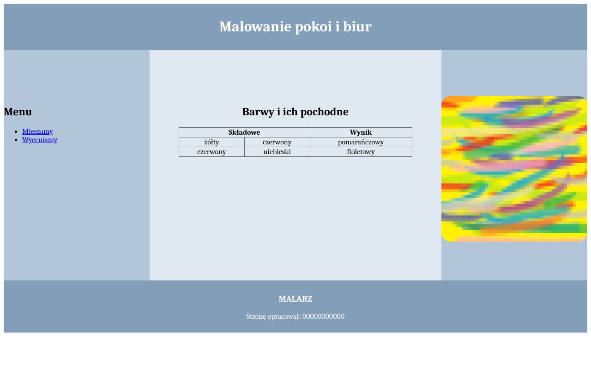
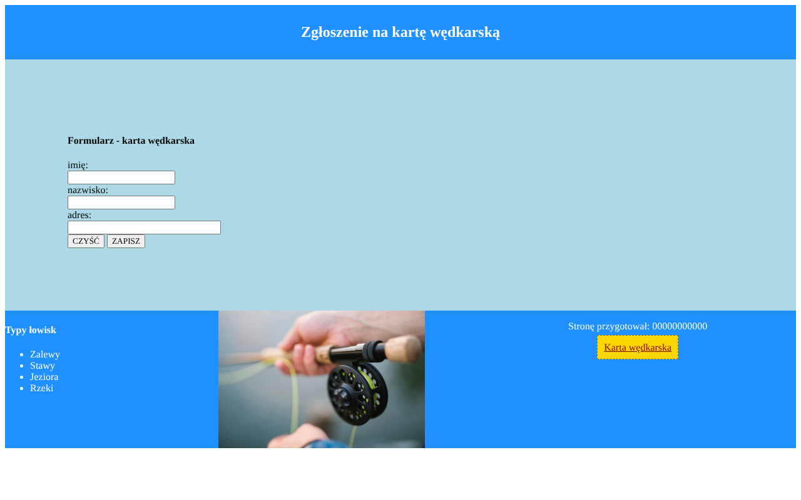

<p>
  
</p>

<p>&nbsp;<a href="README.pl.md"></a></p>

<p>
  
  
  
  <a href="../../actions/workflows/ci.yml"></a>
  
</p>

**Solutions to the Polish practical exams for the IT technician qualification INF.03 (formerly EE.09 and E.14).**
Twelve sessions, each in `exams/<qualification>-<year>-<month>-<task>/` split into `sheet/` (the official exam sheet and its materials), `solution/` (the pages) and `answer/` (all queries with comments and their results). Every solution below was run with PHP 8.3 and MariaDB and screenshotted.

## What I practised

- **HTML and CSS** page layouts as required by the exam sheets.
- **PHP with MySQL**: queries and server-side scripts.
- **SQL queries** saved per task.
- **JavaScript** for the client-side parts.

## Quick start

Requirements: PHP 8 with `mysqli` and MariaDB/MySQL (XAMPP works), Node with Playwright only for screenshots.

```bash
git clone https://github.com/vviktooor/itTechnicianExams.git
cd itTechnicianExams
mysql -e 'CREATE DATABASE wedkowanie' && mysql wedkowanie < exams/inf03-2022-06-anglers-portal/sheet/baza.sql
php -S localhost:8080 -t exams/inf03-2022-06-anglers-portal
# open http://localhost:8080/solution/wedkuj.php
```

Database names, entry pages and query files for every exam are in `exams/exams.json`. `node tools/screenshots.mjs` rebuilds all screenshots.

## Solutions

| Screenshot | Exam | Task | Files |
|---|---|---|---|
| <a href="docs/screenshots/inf03-2023-01-painting.png"></a> | **INF.03** 2023-01 | Painting | [solution](exams/inf03-2023-01-painting/solution/) · [queries](exams/inf03-2023-01-painting/answer/kwerendy.txt) · [exam sheet](exams/inf03-2023-01-painting/sheet/exam.pdf) |
| <a href="docs/screenshots/inf03-2022-06-anglers-portal.png"></a> | **INF.03** 2022-06 | Anglers' portal | [solution](exams/inf03-2022-06-anglers-portal/solution/) · [queries](exams/inf03-2022-06-anglers-portal/answer/kwerendy.txt) · [exam sheet](exams/inf03-2022-06-anglers-portal/sheet/exam.pdf) |
| <a href="docs/screenshots/ee09-2023-01-employee-records.png"></a> | **EE.09** 2023-01 | Employee records | [solution](exams/ee09-2023-01-employee-records/solution/) · [queries](exams/ee09-2023-01-employee-records/answer/kwerendy.txt) · [exam sheet](exams/ee09-2023-01-employee-records/sheet/exam.pdf) |
| <a href="docs/screenshots/ee09-2022-06-wholesale.png"></a> | **EE.09** 2022-06 | Wholesale | [solution](exams/ee09-2022-06-wholesale/solution/) · [queries](exams/ee09-2022-06-wholesale/answer/kwerendy.txt) · [exam sheet](exams/ee09-2022-06-wholesale/sheet/exam.pdf) |
| <a href="docs/screenshots/ee09-2022-01-fishing-card.png"></a> | **EE.09** 2022-01 | Fishing card | [solution](exams/ee09-2022-01-fishing-card/solution/) · [queries](exams/ee09-2022-01-fishing-card/answer/kwerendy.txt) · [exam sheet](exams/ee09-2022-01-fishing-card/sheet/exam.pdf) |
| <a href="docs/screenshots/ee09-2020-06-organizer.png"></a> | **EE.09** 2020-06 | Organizer | [solution](exams/ee09-2020-06-organizer/solution/) · [queries](exams/ee09-2020-06-organizer/answer/kwerendy.txt) · [exam sheet](exams/ee09-2020-06-organizer/sheet/exam.pdf) |
| <a href="docs/screenshots/ee09-2020-06-calendar.png"></a> | **EE.09** 2020-06 | Calendar | [solution](exams/ee09-2020-06-calendar/solution/) · [queries](exams/ee09-2020-06-calendar/answer/kwerendy.txt) · [exam sheet](exams/ee09-2020-06-calendar/sheet/exam.pdf) |
| <a href="docs/screenshots/ee09-2019-06-anglers-portal.png"></a> | **EE.09** 2019-06 | Anglers' portal | [solution](exams/ee09-2019-06-anglers-portal/solution/) · [queries](exams/ee09-2019-06-anglers-portal/answer/kwerendy.txt) · [exam sheet](exams/ee09-2019-06-anglers-portal/sheet/exam.pdf) |
| <a href="docs/screenshots/e14-2020-06-florist.png"></a> | **E.14** 2020-06 | Florist | [solution](exams/e14-2020-06-florist/solution/) · [queries](exams/e14-2020-06-florist/answer/kwerendy.txt) · [exam sheet](exams/e14-2020-06-florist/sheet/exam.pdf) |
| <a href="docs/screenshots/e14-2020-01-computer-shop.png"></a> | **E.14** 2020-01 | Computer shop | [solution](exams/e14-2020-01-computer-shop/solution/) · [queries](exams/e14-2020-01-computer-shop/answer/kwerendy.txt) · [exam sheet](exams/e14-2020-01-computer-shop/sheet/exam.pdf) |
| <a href="docs/screenshots/e14-2019-06-black-friday.png"></a> | **E.14** 2019-06 | Black Friday shop | [solution](exams/e14-2019-06-black-friday/solution/) · [queries](exams/e14-2019-06-black-friday/answer/kwerendy.txt) · [exam sheet](exams/e14-2019-06-black-friday/sheet/exam.pdf) |
| <a href="docs/screenshots/e14-2019-01-film-library.png"></a> | **E.14** 2019-01 | Film library | [solution](exams/e14-2019-01-film-library/solution/) · [queries](exams/e14-2019-01-film-library/answer/kwerendy.txt) · [exam sheet](exams/e14-2019-01-film-library/sheet/exam.pdf) |

## Languages

This README is available in English (default) and [Polish](README.pl.md). Exam pages are in Polish and keep the look required by the CKE exam sheets, so the WR style is not applied to them.

## Repository layout

| Where | What |
|---|---|
| `exams/<exam>/sheet/` | Official exam sheet `exam.pdf` and the original materials (SQL dump, images, texts) |
| `exams/<exam>/solution/` | The solution pages, CSS and images processed as the sheet requires |
| `exams/<exam>/answer/` | `kwerendy.txt` with every query and a comment, `kwN.png` with each query's result |
| `exams/exams.json` | Manifest: entry page, SQL dump, database name, sheet, queries and their expected count |
| `tools/screenshots.mjs` | Loads each database, serves the solution, saves page and query result screenshots |
| `tools/queries.mjs` | Parses `kwerendy.txt`; `check` verifies every exam has all its queries |
| `docs/screenshots/` | Screenshots of the running solutions |

## Tests and quality

```bash
git ls-files -z '*.php' | xargs -0 -n1 php -l
node tools/queries.mjs check
node tools/screenshots.mjs
```

| Check | Result | Date |
|---|---|---|
| php -l | PASS (all PHP files) | 2026-11-26 |
| Queries | PASS (12/12 exams have all queries; every query run on MariaDB, results in `answer/`) | 2026-11-26 |
| Screenshots | PASS (12/12 solutions run with PHP 8.3 + MariaDB, no PHP errors) | 2026-11-26 |

## License

No licence file: all rights reserved. Ask before reusing the code. Author: WR.

Found a bug or have an idea? [Open an issue](../../issues).
