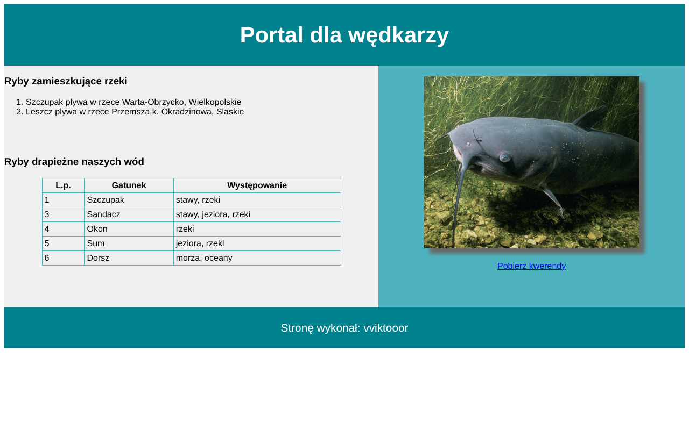
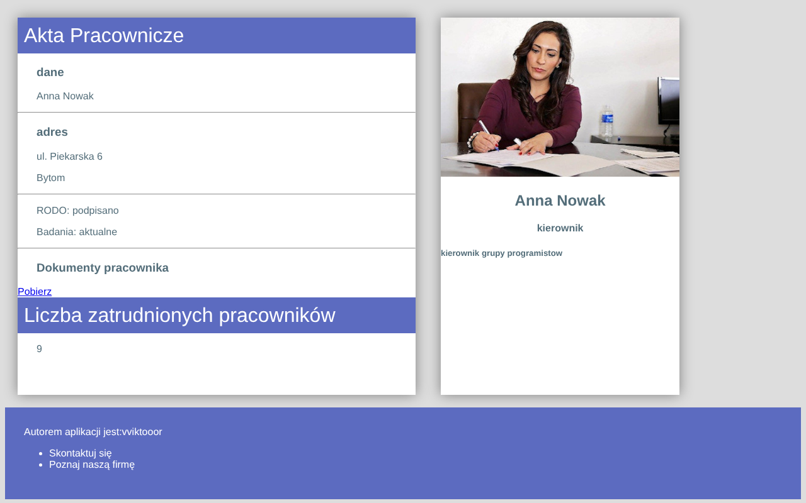
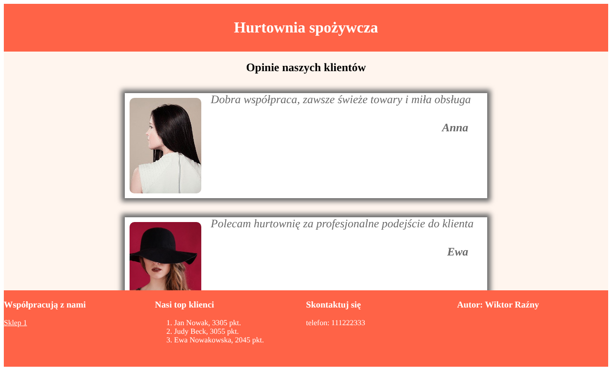
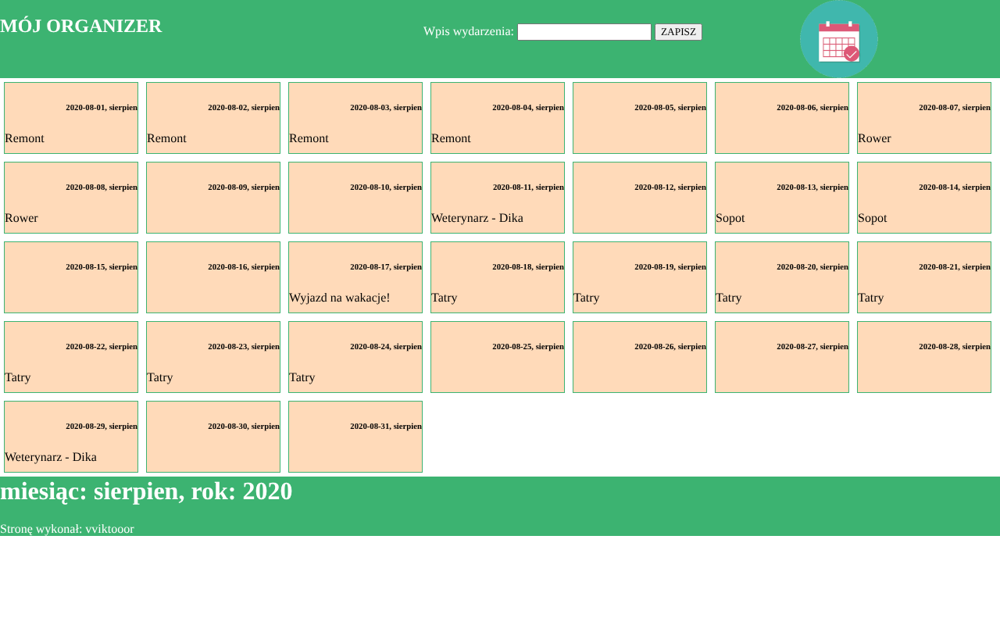
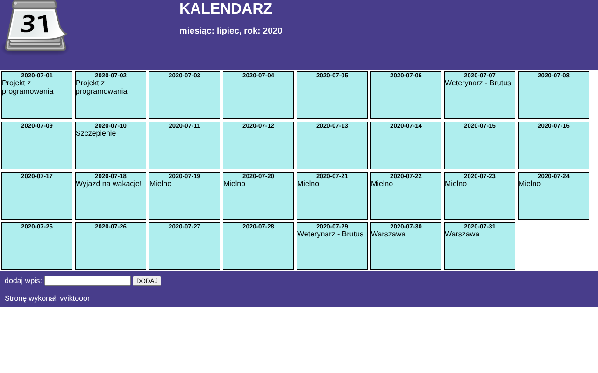
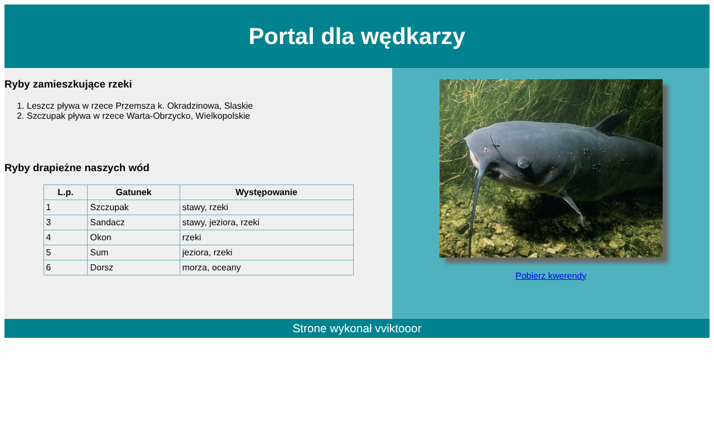
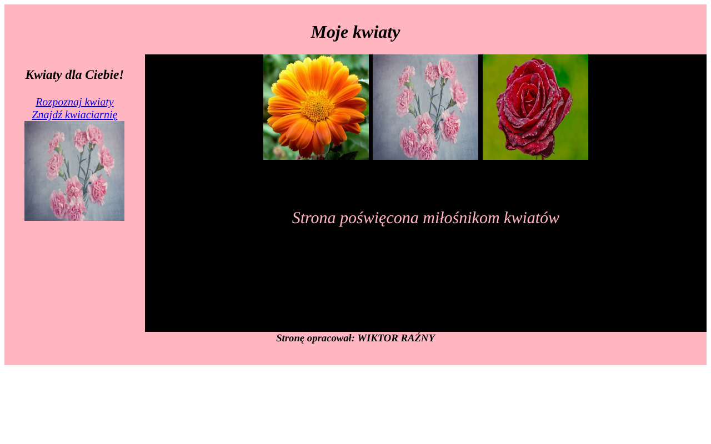
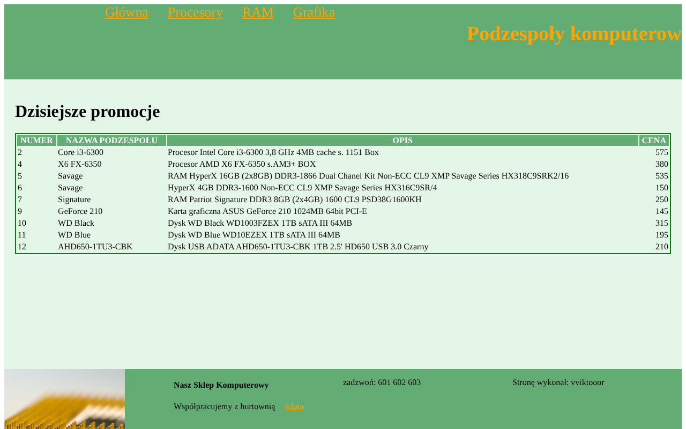
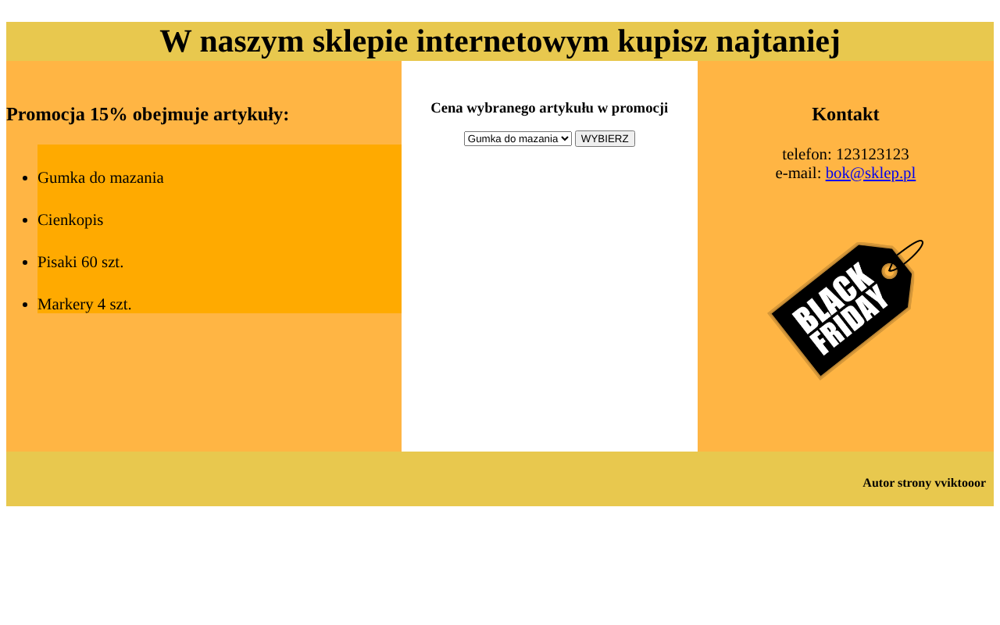
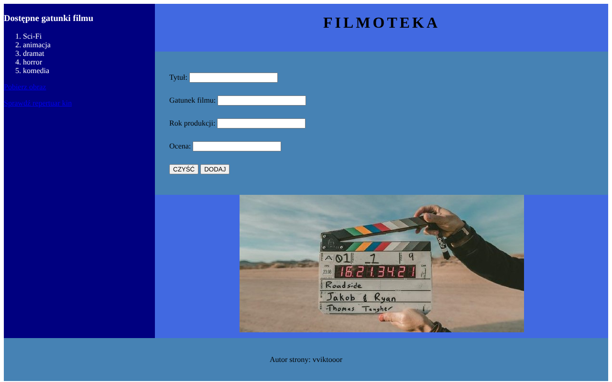

<p>
  
</p>

<p>&nbsp;<a href="README.pl.md"></a></p>

<p>
  
  
  
  <a href="../../actions/workflows/ci.yml"></a>
  
</p>

**Solutions to the Polish practical exams for the IT technician qualification INF.03 (formerly EE.09 and E.14).**
Twelve sessions, each in `exams/<qualification>-<year>-<month>-<task>/` with the official exam sheet, the database dump and my solution. Every solution below was run with PHP 8.3 and MariaDB and screenshotted.

## What I practised

- **HTML and CSS** page layouts as required by the exam sheets.
- **PHP with MySQL**: queries and server-side scripts.
- **SQL queries** saved per task.
- **JavaScript** for the client-side parts.

## Quick start

Requirements: PHP 8 with `mysqli` and MariaDB/MySQL (XAMPP works), Node with Playwright only for screenshots.

```bash
git clone https://github.com/vviktooor/itTechnicianExams.git
cd itTechnicianExams
mysql -e 'CREATE DATABASE wedkowanie' && mysql wedkowanie < exams/inf03-2022-06-anglers-portal/baza.sql
php -S localhost:8080 -t exams/inf03-2022-06-anglers-portal
```

Database names and entry pages for every exam are in `exams/exams.json`. `node tools/screenshots.mjs` rebuilds all screenshots.

## Solutions

| Screenshot | Exam | Task | Files |
|---|---|---|---|
| <a href="docs/screenshots/inf03-2023-01-painting.png"></a> | **INF.03** 2023-01 | Painting | [solution](exams/inf03-2023-01-painting/) · [exam sheet](exams/inf03-2023-01-painting/inf03-2023-styczen-egzamin-zawodowy-praktyczny.pdf) |
| <a href="docs/screenshots/inf03-2022-06-anglers-portal.png"></a> | **INF.03** 2022-06 | Anglers' portal | [solution](exams/inf03-2022-06-anglers-portal/) · [exam sheet](exams/inf03-2022-06-anglers-portal/inf03-2022-czerwiec-egzamin-zawodowy-praktyczny.pdf) |
| <a href="docs/screenshots/ee09-2023-01-employee-records.png"></a> | **EE.09** 2023-01 | Employee records | [solution](exams/ee09-2023-01-employee-records/) · [exam sheet](exams/ee09-2023-01-employee-records/ee09-2023-styczen-egzamin-zawodowy-praktyczny.pdf) |
| <a href="docs/screenshots/ee09-2022-06-wholesale.png"></a> | **EE.09** 2022-06 | Wholesale | [solution](exams/ee09-2022-06-wholesale/) · [exam sheet](exams/ee09-2022-06-wholesale/EE.09-03-22.06-SG.pdf) |
| <a href="docs/screenshots/ee09-2022-01-fishing-card.png"></a> | **EE.09** 2022-01 | Fishing card | [solution](exams/ee09-2022-01-fishing-card/) · [exam sheet](exams/ee09-2022-01-fishing-card/ee09-2022-styczen-egzamin-zawodowy-praktyczny.pdf) |
| <a href="docs/screenshots/ee09-2020-06-organizer.png"></a> | **EE.09** 2020-06 | Organizer | [solution](exams/ee09-2020-06-organizer/) · [exam sheet](exams/ee09-2020-06-organizer/Arkusz%20praktyczny%20EE.09%20-%202020%20-%20czerwiec%20-%20zad.%2001%20%28php%29%20-%20Technik%20informatyk.pdf) |
| <a href="docs/screenshots/ee09-2020-06-calendar.png"></a> | **EE.09** 2020-06 | Calendar | [solution](exams/ee09-2020-06-calendar/) · [exam sheet](exams/ee09-2020-06-calendar/ee.09-03-20.06-SG.pdf) |
| <a href="docs/screenshots/ee09-2019-06-anglers-portal.png"></a> | **EE.09** 2019-06 | Anglers' portal | [solution](exams/ee09-2019-06-anglers-portal/) · [exam sheet](exams/ee09-2019-06-anglers-portal/wedkarz/ee09-2019-czerwiec-egzamin-zawodowy-praktyczny.pdf) |
| <a href="docs/screenshots/e14-2020-06-florist.png"></a> | **E.14** 2020-06 | Florist | [solution](exams/e14-2020-06-florist/) · [exam sheet](exams/e14-2020-06-florist/e_14_2020_06_03_SG_kolor.pdf) |
| <a href="docs/screenshots/e14-2020-01-computer-shop.png"></a> | **E.14** 2020-01 | Computer shop | [solution](exams/e14-2020-01-computer-shop/) · [exam sheet](exams/e14-2020-01-computer-shop/e14_st20_prak1.pdf) |
| <a href="docs/screenshots/e14-2019-06-black-friday.png"></a> | **E.14** 2019-06 | Black Friday shop | [solution](exams/e14-2019-06-black-friday/) · [exam sheet](exams/e14-2019-06-black-friday/e14-2019-czerwiec-egzamin-zawodowy-praktyczny.pdf) |
| <a href="docs/screenshots/e14-2019-01-film-library.png"></a> | **E.14** 2019-01 | Film library | [solution](exams/e14-2019-01-film-library/) · [exam sheet](exams/e14-2019-01-film-library/e14-2019-styczen-egzamin-zawodowy-praktyczny.pdf) |

## Languages

This README is available in English (default) and [Polish](README.pl.md). Exam pages are in Polish and keep the look required by the CKE exam sheets, so the WR style is not applied to them.

## Repository layout

| Where | What |
|---|---|
| `exams/<code>-<yyyy>-<mm>-<task>/` | One exam: sheet (PDF), database dump, solution |
| `exams/exams.json` | Manifest: entry page, SQL dump, database name, sheet |
| `tools/screenshots.mjs` | Loads each database, serves the solution, saves a screenshot |
| `docs/screenshots/` | Screenshots of the running solutions |

## Tests and quality

```bash
git ls-files -z '*.php' | xargs -0 -n1 php -l
node tools/screenshots.mjs
```

| Check | Result | Date |
|---|---|---|
| php -l | PASS (all PHP files) | 2026-11-25 |
| Screenshots | PASS (12/12 solutions run with PHP 8.3 + MariaDB, no PHP errors) | 2026-11-25 |

## License

No licence file: all rights reserved. Ask before reusing the code. Author: WR.

Found a bug or have an idea? [Open an issue](../../issues).
