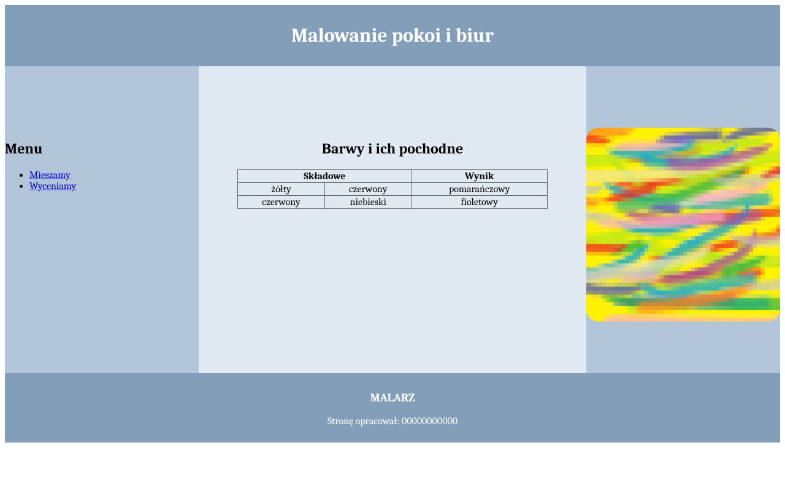
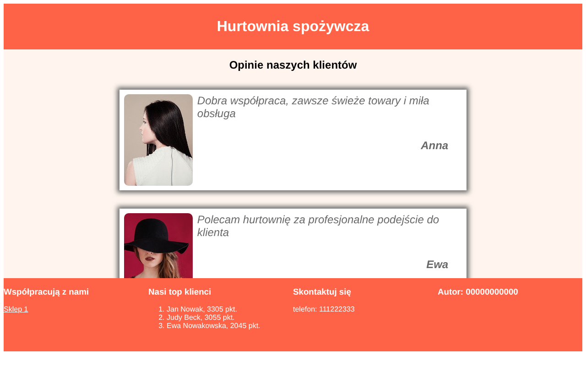
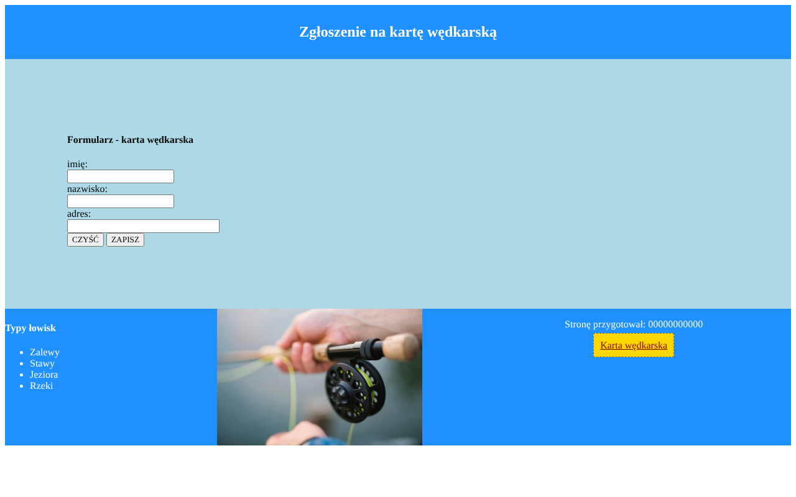
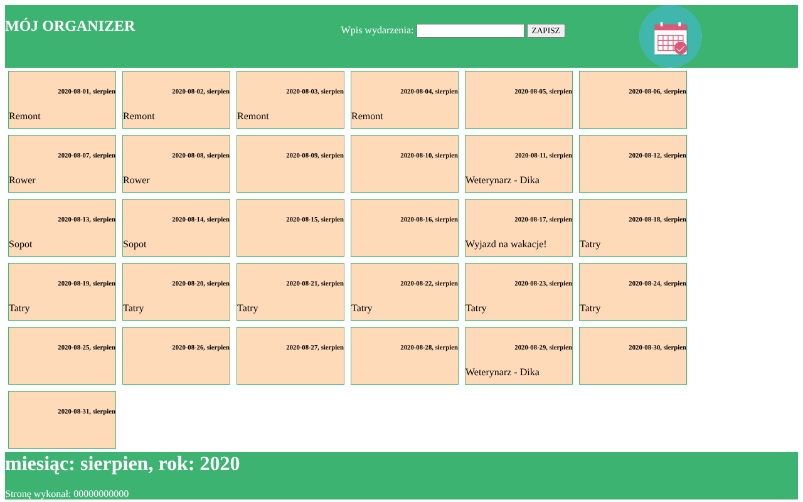
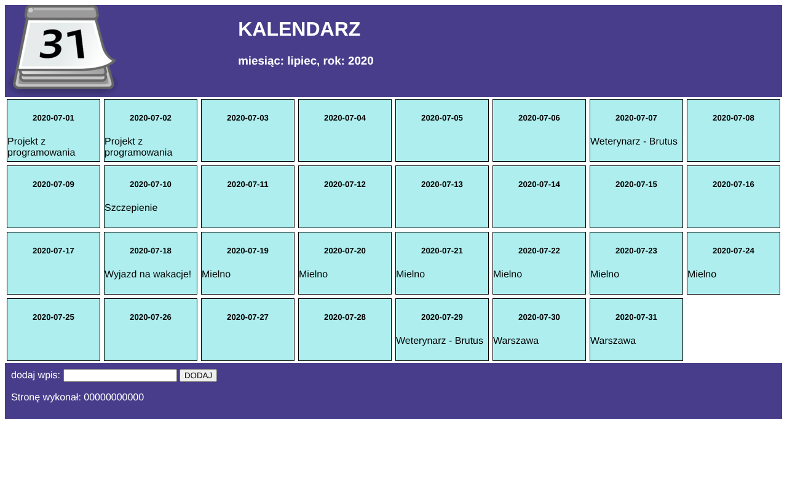
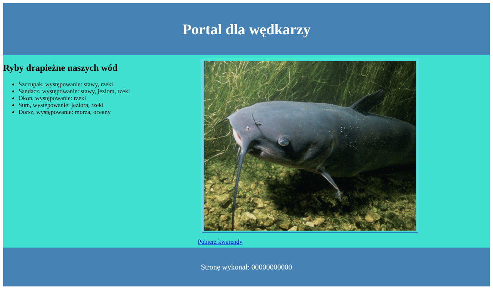
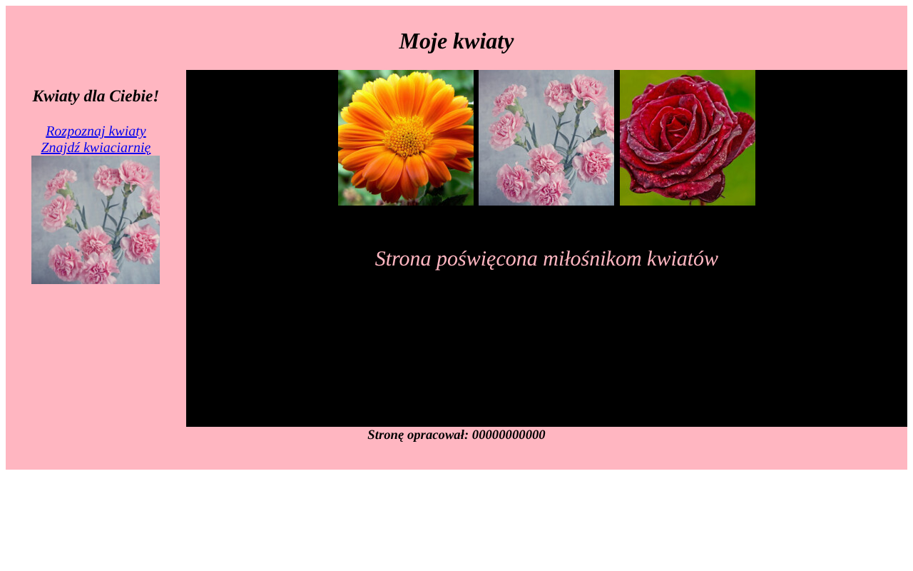
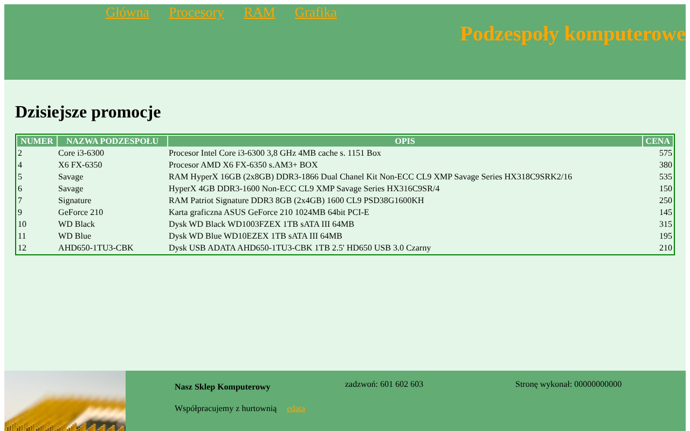
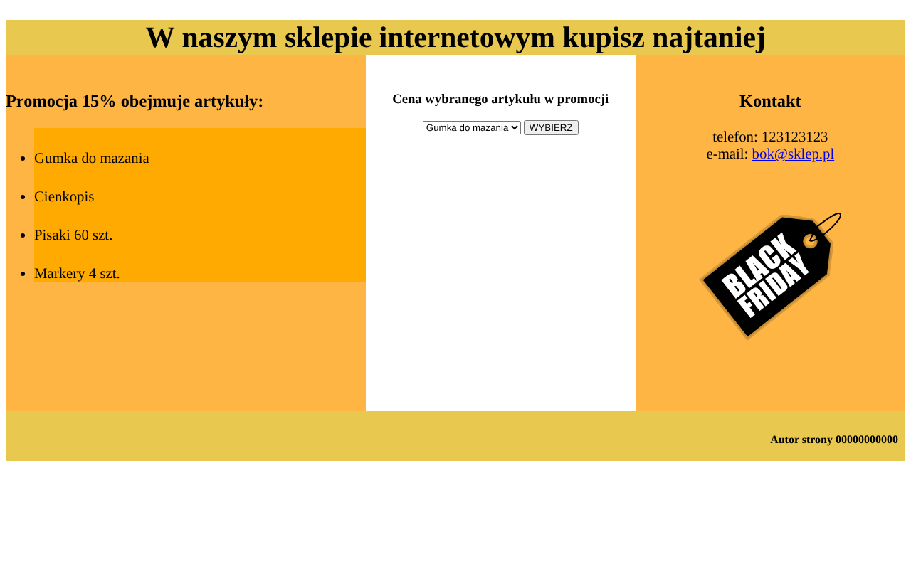
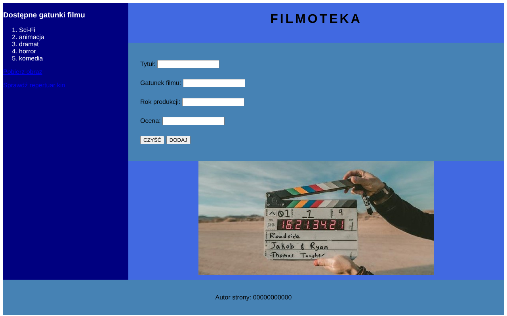

<p>
  
</p>

<p><a href="README.md"></a>&nbsp;</p>

<p>
  
  
  
  <a href="../../actions/workflows/ci.yml"></a>
  
</p>

**Rozwiązania praktycznej części egzaminu zawodowego technik informatyk, kwalifikacja INF.03 (dawniej EE.09 i E.14).**
Dwanaście sesji, każda w `exams/<kwalifikacja>-<rok>-<miesiąc>-<zadanie>/` podzielona na `sheet/` (oficjalny arkusz i materiały), `solution/` (strony) i `answer/` (wszystkie kwerendy z komentarzami i ich wyniki). Każde rozwiązanie poniżej zostało uruchomione na PHP 8.3 i MariaDB i sfotografowane.

## Czego się nauczyłem

- **HTML i CSS**: układy stron zgodne z arkuszami egzaminu.
- **PHP z MySQL**: zapytania i skrypty po stronie serwera.
- **Zapytania SQL** zapisane w każdym zadaniu.
- **JavaScript** w częściach po stronie przeglądarki.

## Szybki start

Wymagania: PHP 8 z `mysqli` i MariaDB/MySQL (działa XAMPP), Node z Playwright tylko do zrzutów.

```bash
git clone https://github.com/vviktooor/itTechnicianExams.git
cd itTechnicianExams
mysql -e 'CREATE DATABASE wedkowanie' && mysql wedkowanie < exams/inf03-2022-06-anglers-portal/sheet/baza.sql
php -S localhost:8080 -t exams/inf03-2022-06-anglers-portal
# otwórz http://localhost:8080/solution/wedkuj.php
```

Nazwy baz, strony startowe i pliki kwerend każdego egzaminu są w `exams/exams.json`. `node tools/screenshots.mjs` odtwarza wszystkie zrzuty.

## Rozwiązania

| Zrzut | Egzamin | Zadanie | Pliki |
|---|---|---|---|
| <a href="docs/screenshots/inf03-2023-01-painting.png"></a> | **INF.03** 2023-01 | Malowanie | [rozwiązanie](exams/inf03-2023-01-painting/solution/) · [kwerendy](exams/inf03-2023-01-painting/answer/kwerendy.txt) · [arkusz](exams/inf03-2023-01-painting/sheet/exam.pdf) |
| <a href="docs/screenshots/inf03-2022-06-anglers-portal.png"></a> | **INF.03** 2022-06 | Portal dla wędkarzy | [rozwiązanie](exams/inf03-2022-06-anglers-portal/solution/) · [kwerendy](exams/inf03-2022-06-anglers-portal/answer/kwerendy.txt) · [arkusz](exams/inf03-2022-06-anglers-portal/sheet/exam.pdf) |
| <a href="docs/screenshots/ee09-2023-01-employee-records.png"></a> | **EE.09** 2023-01 | Akta pracownicze | [rozwiązanie](exams/ee09-2023-01-employee-records/solution/) · [kwerendy](exams/ee09-2023-01-employee-records/answer/kwerendy.txt) · [arkusz](exams/ee09-2023-01-employee-records/sheet/exam.pdf) |
| <a href="docs/screenshots/ee09-2022-06-wholesale.png"></a> | **EE.09** 2022-06 | Hurtownia | [rozwiązanie](exams/ee09-2022-06-wholesale/solution/) · [kwerendy](exams/ee09-2022-06-wholesale/answer/kwerendy.txt) · [arkusz](exams/ee09-2022-06-wholesale/sheet/exam.pdf) |
| <a href="docs/screenshots/ee09-2022-01-fishing-card.png"></a> | **EE.09** 2022-01 | Karta wędkarska | [rozwiązanie](exams/ee09-2022-01-fishing-card/solution/) · [kwerendy](exams/ee09-2022-01-fishing-card/answer/kwerendy.txt) · [arkusz](exams/ee09-2022-01-fishing-card/sheet/exam.pdf) |
| <a href="docs/screenshots/ee09-2020-06-organizer.png"></a> | **EE.09** 2020-06 | Organizer | [rozwiązanie](exams/ee09-2020-06-organizer/solution/) · [kwerendy](exams/ee09-2020-06-organizer/answer/kwerendy.txt) · [arkusz](exams/ee09-2020-06-organizer/sheet/exam.pdf) |
| <a href="docs/screenshots/ee09-2020-06-calendar.png"></a> | **EE.09** 2020-06 | Kalendarz | [rozwiązanie](exams/ee09-2020-06-calendar/solution/) · [kwerendy](exams/ee09-2020-06-calendar/answer/kwerendy.txt) · [arkusz](exams/ee09-2020-06-calendar/sheet/exam.pdf) |
| <a href="docs/screenshots/ee09-2019-06-anglers-portal.png"></a> | **EE.09** 2019-06 | Portal dla wędkarzy | [rozwiązanie](exams/ee09-2019-06-anglers-portal/solution/) · [kwerendy](exams/ee09-2019-06-anglers-portal/answer/kwerendy.txt) · [arkusz](exams/ee09-2019-06-anglers-portal/sheet/exam.pdf) |
| <a href="docs/screenshots/e14-2020-06-florist.png"></a> | **E.14** 2020-06 | Kwiaciarnia | [rozwiązanie](exams/e14-2020-06-florist/solution/) · [kwerendy](exams/e14-2020-06-florist/answer/kwerendy.txt) · [arkusz](exams/e14-2020-06-florist/sheet/exam.pdf) |
| <a href="docs/screenshots/e14-2020-01-computer-shop.png"></a> | **E.14** 2020-01 | Sklep komputerowy | [rozwiązanie](exams/e14-2020-01-computer-shop/solution/) · [kwerendy](exams/e14-2020-01-computer-shop/answer/kwerendy.txt) · [arkusz](exams/e14-2020-01-computer-shop/sheet/exam.pdf) |
| <a href="docs/screenshots/e14-2019-06-black-friday.png"></a> | **E.14** 2019-06 | Sklep Black Friday | [rozwiązanie](exams/e14-2019-06-black-friday/solution/) · [kwerendy](exams/e14-2019-06-black-friday/answer/kwerendy.txt) · [arkusz](exams/e14-2019-06-black-friday/sheet/exam.pdf) |
| <a href="docs/screenshots/e14-2019-01-film-library.png"></a> | **E.14** 2019-01 | Filmoteka | [rozwiązanie](exams/e14-2019-01-film-library/solution/) · [kwerendy](exams/e14-2019-01-film-library/answer/kwerendy.txt) · [arkusz](exams/e14-2019-01-film-library/sheet/exam.pdf) |

## Języki

Ten README jest po polsku i po [angielsku](README.md) (wersja domyślna). Strony egzaminacyjne są po polsku i zachowują wygląd wymagany przez arkusze CKE, dlatego nie mają stylu WR.

## Struktura repozytorium

| Gdzie | Co |
|---|---|
| `exams/<egzamin>/sheet/` | Oficjalny arkusz `exam.pdf` i oryginalne materiały (zrzut SQL, obrazy, teksty) |
| `exams/<egzamin>/solution/` | Strony rozwiązania, CSS i obrazy przetworzone zgodnie z arkuszem |
| `exams/<egzamin>/answer/` | `kwerendy.txt` ze wszystkimi kwerendami i komentarzami, `kwN.png` z wynikiem każdej kwerendy |
| `exams/exams.json` | Manifest: strona startowa, zrzut SQL, nazwa bazy, arkusz, kwerendy i ich oczekiwana liczba |
| `tools/screenshots.mjs` | Ładuje każdą bazę, uruchamia rozwiązanie, zapisuje zrzuty strony i wyników kwerend |
| `tools/queries.mjs` | Czyta `kwerendy.txt`; `check` sprawdza, czy każdy egzamin ma wszystkie kwerendy |
| `docs/screenshots/` | Zrzuty działających rozwiązań |

## Testy i jakość

```bash
git ls-files -z '*.php' | xargs -0 -n1 php -l
node tools/queries.mjs check
node tools/screenshots.mjs
```

| Kontrola | Wynik | Data |
|---|---|---|
| php -l | PASS (wszystkie pliki PHP) | 2026-11-26 |
| Kwerendy | PASS (12/12 egzaminów ma wszystkie kwerendy; każda uruchomiona na MariaDB, wyniki w `answer/`) | 2026-11-26 |
| Zrzuty ekranu | PASS (12/12 rozwiązań uruchomionych na PHP 8.3 + MariaDB, bez błędów PHP) | 2026-11-26 |

## Licencja

Brak pliku licencji: wszelkie prawa zastrzeżone. Zapytaj przed ponownym użyciem kodu. Autor: WR.

Znalazłeś błąd albo masz pomysł? [Zgłoś go w Issues](../../issues).
