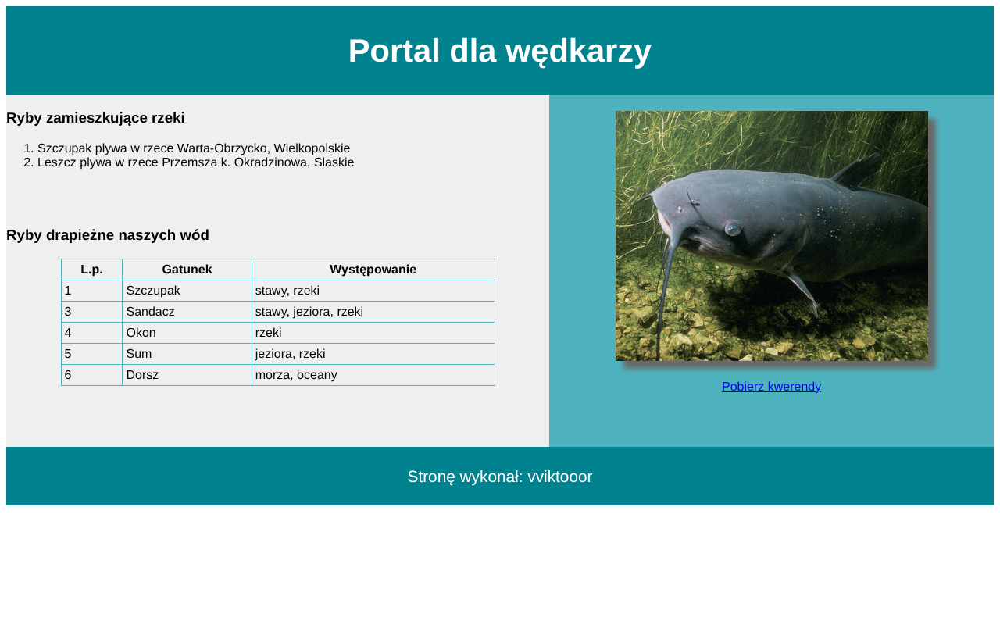
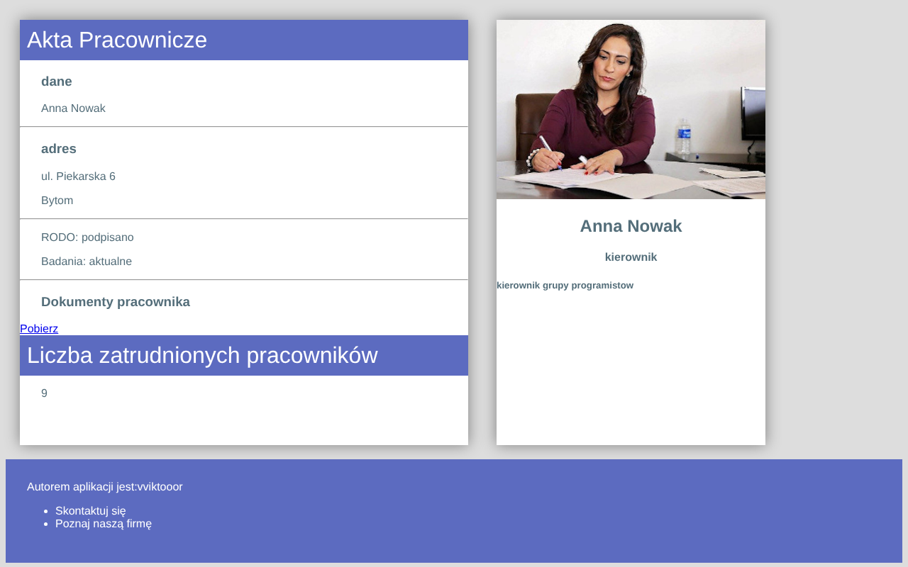

<p>
  
</p>

<p><a href="README.md"></a>&nbsp;</p>

<p>
  
  
  
  <a href="../../actions/workflows/ci.yml"></a>
  
</p>

**Rozwiązania praktycznej części egzaminu zawodowego technik informatyk, kwalifikacja INF.03 (dawniej EE.09 i E.14).**
Dwanaście sesji, każda w `exams/<kwalifikacja>-<rok>-<miesiąc>-<zadanie>/` z oficjalnym arkuszem, zrzutem bazy i moim rozwiązaniem. Każde rozwiązanie poniżej zostało uruchomione na PHP 8.3 i MariaDB i sfotografowane.

## Czego się nauczyłem

- **HTML i CSS**: układy stron zgodne z arkuszami egzaminu.
- **PHP z MySQL**: zapytania i skrypty po stronie serwera.
- **Zapytania SQL** zapisane w każdym zadaniu.
- **JavaScript** w częściach po stronie przeglądarki.

## Szybki start

Wymagania: PHP 8 z `mysqli` i MariaDB/MySQL (działa XAMPP), Node z Playwright tylko do zrzutów.

```bash
git clone https://github.com/vviktooor/itTechnicianExams.git
cd itTechnicianExams
mysql -e 'CREATE DATABASE wedkowanie' && mysql wedkowanie < exams/inf03-2022-06-anglers-portal/baza.sql
php -S localhost:8080 -t exams/inf03-2022-06-anglers-portal
```

Nazwy baz i strony startowe każdego egzaminu są w `exams/exams.json`. `node tools/screenshots.mjs` odtwarza wszystkie zrzuty.

## Rozwiązania

| Zrzut | Egzamin | Zadanie | Pliki |
|---|---|---|---|
| <a href="docs/screenshots/inf03-2023-01-painting.png"></a> | **INF.03** 2023-01 | Malowanie | [rozwiązanie](exams/inf03-2023-01-painting/) · [arkusz](exams/inf03-2023-01-painting/inf03-2023-styczen-egzamin-zawodowy-praktyczny.pdf) |
| <a href="docs/screenshots/inf03-2022-06-anglers-portal.png"></a> | **INF.03** 2022-06 | Portal dla wędkarzy | [rozwiązanie](exams/inf03-2022-06-anglers-portal/) · [arkusz](exams/inf03-2022-06-anglers-portal/inf03-2022-czerwiec-egzamin-zawodowy-praktyczny.pdf) |
| <a href="docs/screenshots/ee09-2023-01-employee-records.png"></a> | **EE.09** 2023-01 | Akta pracownicze | [rozwiązanie](exams/ee09-2023-01-employee-records/) · [arkusz](exams/ee09-2023-01-employee-records/ee09-2023-styczen-egzamin-zawodowy-praktyczny.pdf) |
| <a href="docs/screenshots/ee09-2022-06-wholesale.png"></a> | **EE.09** 2022-06 | Hurtownia | [rozwiązanie](exams/ee09-2022-06-wholesale/) · [arkusz](exams/ee09-2022-06-wholesale/EE.09-03-22.06-SG.pdf) |
| <a href="docs/screenshots/ee09-2022-01-fishing-card.png"></a> | **EE.09** 2022-01 | Karta wędkarska | [rozwiązanie](exams/ee09-2022-01-fishing-card/) · [arkusz](exams/ee09-2022-01-fishing-card/ee09-2022-styczen-egzamin-zawodowy-praktyczny.pdf) |
| <a href="docs/screenshots/ee09-2020-06-organizer.png"></a> | **EE.09** 2020-06 | Organizer | [rozwiązanie](exams/ee09-2020-06-organizer/) · [arkusz](exams/ee09-2020-06-organizer/Arkusz%20praktyczny%20EE.09%20-%202020%20-%20czerwiec%20-%20zad.%2001%20%28php%29%20-%20Technik%20informatyk.pdf) |
| <a href="docs/screenshots/ee09-2020-06-calendar.png"></a> | **EE.09** 2020-06 | Kalendarz | [rozwiązanie](exams/ee09-2020-06-calendar/) · [arkusz](exams/ee09-2020-06-calendar/ee.09-03-20.06-SG.pdf) |
| <a href="docs/screenshots/ee09-2019-06-anglers-portal.png"></a> | **EE.09** 2019-06 | Portal dla wędkarzy | [rozwiązanie](exams/ee09-2019-06-anglers-portal/) · [arkusz](exams/ee09-2019-06-anglers-portal/wedkarz/ee09-2019-czerwiec-egzamin-zawodowy-praktyczny.pdf) |
| <a href="docs/screenshots/e14-2020-06-florist.png"></a> | **E.14** 2020-06 | Kwiaciarnia | [rozwiązanie](exams/e14-2020-06-florist/) · [arkusz](exams/e14-2020-06-florist/e_14_2020_06_03_SG_kolor.pdf) |
| <a href="docs/screenshots/e14-2020-01-computer-shop.png"></a> | **E.14** 2020-01 | Sklep komputerowy | [rozwiązanie](exams/e14-2020-01-computer-shop/) · [arkusz](exams/e14-2020-01-computer-shop/e14_st20_prak1.pdf) |
| <a href="docs/screenshots/e14-2019-06-black-friday.png"></a> | **E.14** 2019-06 | Sklep Black Friday | [rozwiązanie](exams/e14-2019-06-black-friday/) · [arkusz](exams/e14-2019-06-black-friday/e14-2019-czerwiec-egzamin-zawodowy-praktyczny.pdf) |
| <a href="docs/screenshots/e14-2019-01-film-library.png"></a> | **E.14** 2019-01 | Filmoteka | [rozwiązanie](exams/e14-2019-01-film-library/) · [arkusz](exams/e14-2019-01-film-library/e14-2019-styczen-egzamin-zawodowy-praktyczny.pdf) |

## Języki

Ten README jest po polsku i po [angielsku](README.md) (wersja domyślna). Strony egzaminacyjne są po polsku i zachowują wygląd wymagany przez arkusze CKE, dlatego nie mają stylu WR.

## Struktura repozytorium

| Gdzie | Co |
|---|---|
| `exams/<code>-<yyyy>-<mm>-<task>/` | Jeden egzamin: arkusz (PDF), zrzut bazy, rozwiązanie |
| `exams/exams.json` | Manifest: strona startowa, zrzut SQL, nazwa bazy, arkusz |
| `tools/screenshots.mjs` | Ładuje każdą bazę, uruchamia rozwiązanie, zapisuje zrzut |
| `docs/screenshots/` | Zrzuty działających rozwiązań |

## Testy i jakość

```bash
git ls-files -z '*.php' | xargs -0 -n1 php -l
node tools/screenshots.mjs
```

| Kontrola | Wynik | Data |
|---|---|---|
| php -l | PASS (wszystkie pliki PHP) | 2026-11-25 |
| Zrzuty ekranu | PASS (12/12 rozwiązań uruchomionych na PHP 8.3 + MariaDB, bez błędów PHP) | 2026-11-25 |

## Licencja

Brak pliku licencji: wszelkie prawa zastrzeżone. Zapytaj przed ponownym użyciem kodu. Autor: WR.

Znalazłeś błąd albo masz pomysł? [Zgłoś go w Issues](../../issues).
